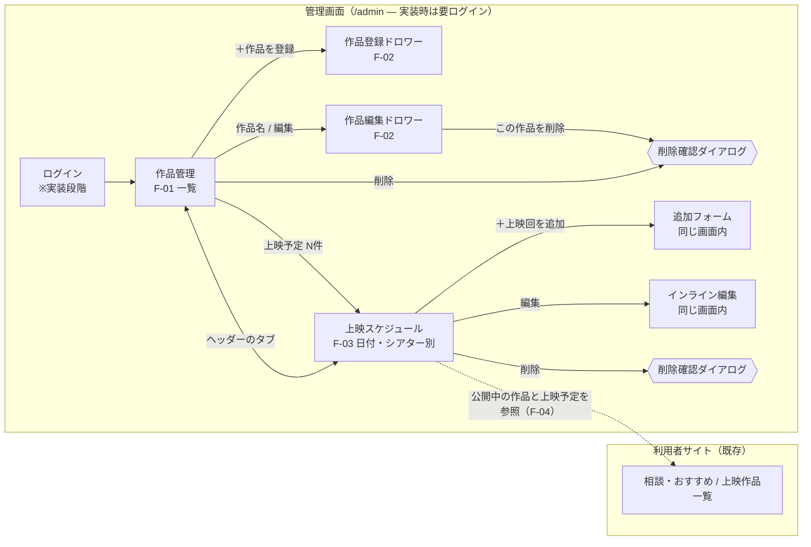

# Phase 2：映画館向け 作品・上映スケジュール管理 — 要求定義〜UIモック

- 対象ブランチ：`claude/phase2-admin-ui-mock`（`main` = `20b5394` から作成）
- 工程：要求定義 → 基本設計 → **UIモック（本書の範囲）** → ユーザーUI確認 → 詳細設計 → 実装 → テスト
- 状態：UIモック承認済み（`139a9a5`）。詳細設計 rev.2（レビュー「REVISE」への対応）の**再レビュー待ち**。バックエンド・永続化・認証は未実装

| 資料 | 内容 |
| --- | --- |
| `README.md`（本書） | 要求定義、機能要件、画面遷移図、UIモック、スクリーンショット、基本設計時のデータ構造案、データソースの調査観点 |
| [`detailed-design.md`](./detailed-design.md) | **詳細設計書**（DB・ER図・テーブル定義、認証・RLS、上映スケジュール、公開状態、推薦機能との連携、API 仕様、画面と API の対応、移行計画、テスト計画、実装タスク、未解決事項） |
| [`schema-draft.sql`](./schema-draft.sql) | Supabase のスキーマ・RLS・関数の SQL 設計案（**実行していない**） |
| [`legacy-admin-comparison.md`](./legacy-admin-comparison.md) | 旧管理画面（movie-ai-chatbot）との比較、再利用する機能、一括登録の要求定義、設計更新案（**提案・確認待ち**） |

### UIレビュー結果（承認事項）

気分タグの追加、上映回の追加・編集・削除を1画面で行う設計、シアター別管理、入れ替え時間15分（初期値）、PC・スマートフォン両対応は承認済み。

### 修正指示への対応

| 指示 | 対応 |
| --- | --- |
| 上映回を自動で除外しない | 既存の架空上映回（7日間で89回）をすべて保持。どのシアターにも入らない回は「未割り当て」として残す |
| 未割り当て件数の確認 | ナビゲーションの「上映スケジュール」に件数バッジ、画面上部に警告帯（日付別の内訳）、日付ボタンに「未割当 N」を表示 |
| シアターを選んで割り当て | 未割り当ての上映回ごとに「シアターを選択 → 割り当て」を用意。編集フォームでもシアター（未割り当てを含む）を変更できる |
| 重複時は原因を表示 | 割り当て・追加・編集の際に重なる場合は、相手の上映回（シアター・作品・時刻・入れ替え時間）を表示して保存しない。作品の上映時間を変更して既存の回が重なった場合も、各上映回に「重複：…」を表示 |
| 重複した上映回を自動削除しない | 重なりや未割り当てを理由にデータを変更・削除する処理は持たない。削除はスタッフの確認ダイアログ経由のみ |
| シアター数を館ごとに設定できる構造 | 詳細設計で `screens` テーブル（館ごとに1〜N件）とする（§6）。モックは3シアター固定のまま |
| データの整合性 | 「表示上の都合で上映データを変更・除外しない」を設計原則に追加（§6.1） |

UIモックの確認方法（開発サーバーのみ。本番・Preview ビルドには含まれない）：

```bash
npm install
npm run dev
# ブラウザで http://localhost:5173/admin-mock.html
```

---

## 1. 要求定義書（簡潔版）

| 項目 | 内容 |
| --- | --- |
| 背景 | MVP は作品・上映予定がコード（`shared/films.ts`）に固定されており、映画館スタッフが変更できない |
| 目的 | スタッフが作品情報と上映スケジュールを自分で登録・編集し、その内容を利用者向け推薦がそのまま参照できるようにする |
| 利用者 | 小規模映画館（1〜3スクリーン程度）のスタッフ。PC（事務所）とスマートフォン（館内）の両方で操作する |
| 将来像 | 小規模映画館向け SaaS（複数館。館ごとにデータを分離） |
| 成功基準 | 1回分の上映予定を30秒以内に追加できる。重複登録を画面上で防止できる。登録内容が利用者サイトの推薦に反映される（実装段階） |
| 制約 | 既存の推薦機能と Gemini 連携を壊さない。認証のない管理画面を公開しない。実在映画のデータ・画像・TMDb は使わない |
| 今回の範囲外 | 認証・権限、DB（Supabase）接続、永続化、料金・予約・座席、複数館の切り替え、外部映画データの取り込み |

## 2. 機能要件一覧

| ID | 機能 | 内容 | モック |
| --- | --- | --- | --- |
| F-01 | 作品一覧 | 作品名・ジャンル・監督・上映時間・公開状態・登録済み上映予定数（今日以降）を表示。作品名・監督での検索、公開状態での絞り込み | ✅ |
| F-02 | 作品登録・編集 | 作品名・あらすじ・ジャンル・監督・上映時間・公開状態を入力。必須項目と文字数の検証。削除時は確認ダイアログを出し、紐づく上映予定の件数を警告 | ✅ |
| F-02a | 気分タグ（追加提案） | 推薦機能は「気分」で絞り込むため、作品ごとに任意で設定できるようにした（F-04 との連携に必要） | ✅ |
| F-03 | 上映スケジュール管理 | 日付別（7日間）、シアター別に上映回を一覧表示。同じ画面で追加・インライン編集・削除（確認あり）ができる。終了時刻を自動計算し、同じシアターでの時間の重なり（入れ替え15分を含む）を検出 | ✅ |
| F-03b | 未割り当ての管理 | シアターが決まっていない上映回を「未割り当て」として保持・表示。件数をナビゲーション・警告帯・日付ボタンで確認でき、シアターを選んで割り当てられる | ✅ |
| F-03c | 重複の原因表示 | 時間が重なる上映回に、相手の上映回と入れ替え時間を含む原因を表示。重なった回は自動で削除・移動しない | ✅ |
| F-03a | 作品で絞り込み | 作品一覧の「上映予定 N件」から、その作品のスケジュールに移動できる | ✅ |
| F-04 | 推薦機能との連携 | 公開中の作品と上映予定を、推薦 API が同じデータ構造から参照する（§6） | 設計のみ |
| N-01 | デモ表示 | 管理画面の全ページに「デモ・認証未実装・保存されない」帯を常に表示 | ✅ |
| N-02 | レスポンシブ | 375px：作品表はカード表示、フォームは全画面、シアターは縦に並べる。1440px：表と3列のシアター表示 | ✅ |
| N-03 | アクセシビリティ | キーボード操作、`<dialog>` によるフォーカス管理、Esc で閉じる、入力エラーを `role=alert` で通知 | ✅ |

### 公開状態の定義

| 値 | 表示 | 利用者サイト |
| --- | --- | --- |
| `published` | 公開中 | 推薦と上映予定に表示する |
| `draft` | 準備中 | 表示しない（スタッフのみ） |
| `archived` | 上映終了 | 表示しない。上映予定を追加する際の選択肢からも外す |

## 3. 画面遷移図



## 4. 管理画面 UIモック

| ファイル | 役割 |
| --- | --- |
| `admin-mock.html` | 開発サーバー専用の入口。`vite build` の入力は `index.html` だけなので、`dist/` には出力されない（ビルドで確認済み） |
| `src/admin/AdminApp.tsx` | 画面（作品管理・作品ドロワー・上映スケジュール・確認ダイアログ・トースト） |
| `src/admin/mockData.ts` | `shared/films.ts` の架空6作品から、メモリ上のモックデータを生成。重複判定と時刻計算 |
| `src/admin/admin.css` | 管理画面のスタイル。色や基本要素は利用者サイトの `styles.css` を共有 |

既存の `src/App.tsx`、`shared/`、`server/`、`api/` には手を加えていない。

**モックデータについて**：既存の架空上映時刻はシアターを想定していないため、同じ時間帯に上映が集中している。開始時刻の早い順に3シアターへ重ならないよう割り当て、どのシアターにも入らない回は**除外せず「未割り当て」として保持**する。7日間の全89回のうち、78回が割り当て済み、11回が未割り当て。管理画面と利用者サイトの上映回は一致している。

## 5. スクリーンショット

| 画面 | 1440px | 375px |
| --- | --- | --- |
| 作品一覧 | `screenshots/01-films-1440.png` | `screenshots/01-films-375.png` |
| 作品登録（入力エラー表示） | `screenshots/02-film-new-validation-1440.png` | `screenshots/02-film-new-validation-375.png` |
| 作品編集 | `screenshots/03-film-edit-1440.png` | `screenshots/03-film-edit-375.png` |
| 作品削除の確認 | `screenshots/04-film-delete-confirm-1440.png` | `screenshots/04-film-delete-confirm-375.png` |
| 上映スケジュール | `screenshots/05-schedule-1440.png` | `screenshots/05-schedule-375.png` |
| 上映回の追加（重複エラー） | `screenshots/06-schedule-add-conflict-1440.png` | `screenshots/06-schedule-add-conflict-375.png` |
| 上映回のインライン編集 | `screenshots/07-schedule-inline-edit-1440.png` | `screenshots/07-schedule-inline-edit-375.png` |
| 未割り当て（件数・警告帯・割り当てUI） | `screenshots/08-unassigned-1440.png` | `screenshots/08-unassigned-375.png` |
| 割り当て時の重複（原因表示） | `screenshots/09-assign-conflict-1440.png` | `screenshots/09-assign-conflict-375.png` |
| 未割り当ての回を編集してシアターへ移した後（件数 11→10） | `screenshots/10-after-assign-1440.png` | `screenshots/10-after-assign-375.png` |
| 上映時間の変更で生じた重複の表示（削除されない） | `screenshots/11-conflict-warning-1440.png` | `screenshots/11-conflict-warning-375.png` |

撮影に使った Playwright のロケールが英語のため、時刻入力が「AM/PM」で表示されている。日本語環境のブラウザでは24時間表記になる。

## 6. データ構造の設計案（実装段階用・未作成）

> 基本設計時の案。詳細は [`detailed-design.md`](./detailed-design.md) を優先する（上映回の状態 `draft`/`confirmed`、営業日、複合外部キー、排他制約などを追加した）。

### 6.1 方針

- **上映データは正本として扱い、表示の都合で変更・除外しない**：未割り当てや時間の重なりがあっても、上映回は保持してスタッフに判断を委ねる。システムが自動で削除・移動・補正することはしない。
- **管理画面と利用者サイトで上映予定を一致させる**：両者は同じ `showtimes` を参照する。利用者サイトは公開中の作品の上映回をすべて表示し、シアターが割り当て済みかどうかで表示を変えない（シアターは館内の運用情報）。
- **シアター数は館ごとに設定する**：`screens` を館ごとに1〜N件持つ。1スクリーンの館は1件だけ登録する。シアター管理画面は詳細設計で扱う（今回のモックは3件固定）。
- **館（theater）単位でデータを分ける**：すべてのテーブルに `theater_id` を持たせ、Supabase の RLS（行単位のアクセス制御）で「自分の館のスタッフだけが読み書きできる」ようにする。
- **上映予定は「回」単位で持つ**：MVP の `times[]` と `offDays[]` は廃止し、1回の上映を1行（`showtimes`）にする。
- **時刻**：`starts_at` は `timestamptz` で保存し、表示と日付の区切りは館のタイムゾーン（`Asia/Tokyo`）で行う。終了時刻は保存せず、作品の上映時間から計算する（深夜0時をまたぐ回にも対応）。
- **推薦との接続**：推薦ロジック（`shared/recommend.ts`）がデータの取り出し方を知らなくて済むよう、取得部分を Repository インターフェースで分離する。まずは今の静的データを返す実装を用意し、後から Supabase 実装に差し替える。
- **フロントからの書き込み**：Supabase JS を使い、RLS で守る。推薦 API（`/api/recommend`）は読み取り専用で、公開中の作品だけを参照する。

### 6.2 TypeScript 型（案）

```ts
type FilmStatus = "published" | "draft" | "archived";

interface Theater { id: string; name: string; timezone: string /* "Asia/Tokyo" */ }
interface Screen  { id: string; theaterId: string; name: string; sortOrder: number }

interface Film {
  id: string; theaterId: string;
  title: string; synopsis: string;
  genres: Genre[]; moods: Mood[];          // 既存の GENRES / MOODS の値に限定
  director: string; runtimeMinutes: number;
  status: FilmStatus;
  createdAt: string; updatedAt: string;
}

interface Showtime {
  id: string; theaterId: string;
  screenId: string | null;                  // null = 未割り当て（上映回は保持する）
  filmId: string;
  startsAt: string;                         // ISO 8601（timestamptz）
  createdAt: string; updatedAt: string;
}

// 推薦機能が使うのはこの読み取り用インターフェースだけ
interface ScheduleRepository {
  listBookableFilms(theaterId: string, date: string): Promise<Array<{ film: Film; times: string[] }>>;
}
```

### 6.3 Supabase テーブル案（SQL の下書き。まだ実行しない）

```sql
create type film_status as enum ('published', 'draft', 'archived');

create table theaters (id uuid primary key default gen_random_uuid(), name text not null, timezone text not null default 'Asia/Tokyo', turnover_minutes int not null default 15 check (turnover_minutes between 0 and 120));
create table screens  (id uuid primary key default gen_random_uuid(), theater_id uuid not null references theaters on delete cascade, name text not null, sort_order int not null default 0);
create table theater_staff (theater_id uuid references theaters on delete cascade, user_id uuid references auth.users on delete cascade, role text not null default 'staff', primary key (theater_id, user_id));

create table films (
  id uuid primary key default gen_random_uuid(),
  theater_id uuid not null references theaters on delete cascade,
  title text not null check (char_length(title) between 1 and 60),
  synopsis text not null default '' check (char_length(synopsis) <= 300),
  genres text[] not null check (cardinality(genres) >= 1),
  moods text[] not null default '{}',
  director text not null,
  runtime_minutes int not null check (runtime_minutes between 1 and 400),
  status film_status not null default 'draft',
  created_at timestamptz not null default now(), updated_at timestamptz not null default now()
);

create table showtimes (
  id uuid primary key default gen_random_uuid(),
  theater_id uuid not null references theaters on delete cascade,
  screen_id uuid references screens on delete set null,   -- null = 未割り当て。シアターを削除しても上映回は残す
  film_id uuid not null references films on delete cascade,
  starts_at timestamptz not null,
  created_at timestamptz not null default now(), updated_at timestamptz not null default now()
);
create index on showtimes (theater_id, starts_at);
-- 同じシアターでの時間の重なりは、アプリ側の検証に加えて DB 側でも防ぐ（screen_id が null の行は対象外）。
-- 作品の上映時間を後から延ばした場合、既存の行は削除・変更せず、重なりを一覧として返すクエリでスタッフに提示する。
-- 実装方法（btree_gist による排他制約か、トリガーと検査用ビューか）は詳細設計で決める。
-- 入れ替え時間は館ごとの設定値（theaters.turnover_minutes, 初期値 15）にする

-- RLS：スタッフは自館のデータのみ読み書きできる。一般利用者は公開中の作品と上映予定だけを読める
alter table films enable row level security;
alter table showtimes enable row level security;
```

### 6.4 MVP データからの移行

`shared/films.ts` の6作品を `films` テーブルの初期データにする。`times` と `offDays` からは、7日分の `showtimes` を**すべて**生成する。シアターに入らない回は `screen_id = null` で登録し、除外しない（UIモックの `mockData.ts` と同じ考え方）。移行後に、管理画面の上映回の件数と利用者サイトの上映回の件数が一致することをテストで確認する。

## 7. 次の実装で必要なタスク一覧

| # | タスク | 備考 |
| --- | --- | --- |
| 1 | 詳細設計を確定する | 画面項目、検証ルール、エラー文言、未割り当て・重複の扱い、シアター数の設定（館ごと） |
| 1a | シアター設定（館ごとに1〜N件、入れ替え時間）の画面または初期設定手順を設計する | 今回のモックでは実装しない |
| 2 | **認証方式を決める**（Supabase Auth のメールリンクなど）。`/admin` をログイン必須にする | 認証なしでは公開しない |
| 3 | Supabase プロジェクトを作成し、テーブル・RLS・初期データを用意する | 本番と開発でプロジェクトを分ける |
| 4 | `ScheduleRepository` を導入し、`shared/recommend.ts` が静的データを直接参照しないように変える | 推薦ロジックそのものは変えない。既存テストで後退がないことを確認 |
| 5 | 推薦 API を Supabase 実装（読み取り専用・公開中の作品のみ）に切り替える | 失敗時は静的データかローカル推薦に切り替える |
| 6 | 管理画面のデータ取得・保存（作品の CRUD、上映回の CRUD）を実装する | 楽観的更新、通信エラー時の表示 |
| 7 | 重複判定をサーバー側・DB 制約でも行う | UI の判定だけに頼らない |
| 8 | 利用者サイトの日付を `Asia/Tokyo` 基準に統一する | 現状はブラウザ側の日付 |
| 9 | テスト（Repository の単体テスト、RLS のテスト、管理画面の E2E、375px/1440px） | |
| 10 | 運用面の追加候補：前日・前週の上映予定をコピー、CSV 取り込み、変更履歴 | UI確認の結果で優先度を決める |
| 11 | デプロイ：Preview 環境の保護（Vercel Deployment Protection）を確認し、管理画面の公開範囲を制限する | |

## 8. 未実装の項目（このモックの範囲外）

- 永続化（再読み込みで初期データに戻る）、Supabase、API
- 認証・権限・ログイン画面・館の切り替え
- 利用者サイトへの反映（F-04 は設計のみ）
- 深夜0時をまたぐ上映回の日付処理、祝日・休館日の設定
- 上映予定の一括登録やコピー、CSV 入出力
- シアター（スクリーン）自体の追加・編集、入れ替え時間の変更（モックでは3シアター・15分に固定）
- 未割り当ての回の一括割り当て（1件ずつ割り当てる）
- 作品画像（権利の確認が済むまで扱わない）

## 9. 別途調査：商用利用できる映画情報データソース

**今回は調査項目と判断基準の整理だけを行い、実際の確認や実装はしていない。** 各候補の条件は、必ず一次情報（公式の利用規約、ライセンス文書、契約書）で確認すること。下表の「確認の焦点」は推測を含む調査の出発点であり、結論ではない。

### 9.1 判断基準（すべて一次情報で確認する）

| 観点 | 確認すること |
| --- | --- |
| 著作権・ライセンス | データ本体のライセンス（CC0、CC BY、独自規約など）。項目ごとにライセンスが違わないか（例：あらすじ文と構造化データ） |
| 商用利用 | 有償 SaaS で使えるか。別途契約や費用が必要か |
| 再配布 | 自社 DB に保存・キャッシュしてよいか。保存期間に制限はあるか。顧客（映画館）へ提供してよいか |
| 画像 | ポスター・スチル画像の権利者は誰か（配給会社、写真家など）。個別に許諾が要るか。データ提供元が画像の権利まで持っているか |
| 表示義務 | クレジット・ロゴの表示義務、リンクの必要性 |
| 技術・運用 | API の有無、呼び出し回数の制限、SLA、日本語データの充実度、更新頻度、サービス終了時の扱い |
| 契約・責任 | 準拠法、免責、規約の変更通知、解約後にデータを削除する義務 |

### 9.2 調査候補（未確認）

| 候補 | 確認の焦点 |
| --- | --- |
| 映画館自身による入力（Phase 2 の方式） | 権利関係が最も明確。館が持つ素材（配給会社から提供されたプレス資料など）の利用範囲を、利用規約で館側の責任として定める |
| 配給会社・宣伝会社からの直接提供 | 提供されるプレス資料（あらすじ、画像）を Web で掲載できる範囲と期間 |
| Wikidata | 構造化データは CC0 とされているか。Wikipedia の本文や Commons の画像は別ライセンス（CC BY-SA など、ファイルごとに異なる）である点を確認 |
| 文化庁 日本映画情報システム、JMDb などの国内データベース | 利用規約、API の有無、商用・再配布の可否 |
| 商用ライセンスで提供されるメタデータ事業者 | 契約条件、費用、日本作品のカバー範囲 |
| IMDb の公開データセット | 非商用目的に限定されていないか（商用には別途ライセンスが必要か） |
| TMDb | **今回の方針で使用しない**。商用利用に別途契約が必要とされている点を、将来再検討する場合に確認 |
| 映画情報サイトのスクレイピング | 原則として不可を前提に、利用規約で禁止されていないかを確認する（推奨しない） |

**結論を出す前の前提**：RAG や AI による要約は、権利処理の代わりにならない。生成したあらすじであっても、元データの規約に従う必要がある。
