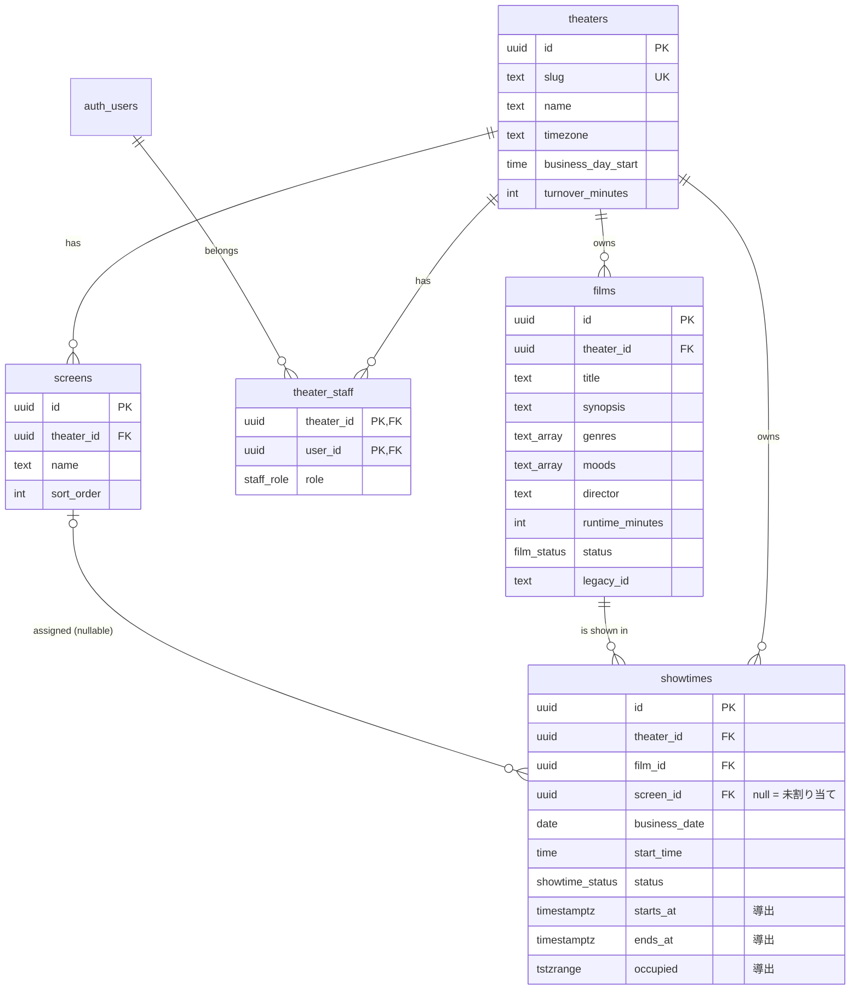

# Phase 2 詳細設計書：作品・上映スケジュール管理と推薦機能の連携

| 項目 | 内容 |
| --- | --- |
| 前工程 | 管理画面 UIモック（`139a9a5`、承認済み）、要求定義・基本設計（`README.md`） |
| 本書の範囲 | D-01 DB／D-02 認証・認可／D-03 上映スケジュール／D-04 公開状態／D-05 推薦連携／D-06 API。あわせて移行計画・テスト計画・実装タスク |
| 版 | rev.2（詳細設計レビュー「REVISE」への対応。変更点は §0） |
| 状態 | **再レビュー待ち**。Supabase プロジェクトの作成、DB 構築、実装、デプロイは行っていない |
| SQL | `schema-draft.sql`（rev.2。設計案。どの環境でも実行しておらず、構文も未検証） |

## 0. rev.2 の変更点（レビュー対応）

| # | レビュー指摘・回答 | 反映内容 | 該当箇所 |
| --- | --- | --- | --- |
| R1 | 上映時間の変更で重なる場合は保存を拒否する（採用） | 確定事項として記載。重なる上映回の一覧を返し、自動で削除・移動しない。スタッフが調整した後に再保存する | §3.3、§6.3 |
| R2 | 新しい上映回の初期状態は「下書き」 | DB の既定値と画面の初期値をどちらも `draft` にした。利用者サイトの公開候補になるのは、スタッフが「確定」を選んだ回だけ | §4、§6.3 |
| R3 | 上映中の回も上映スケジュールに表示する。推薦はこれから観られる回を優先する。終了した回は除外 | 公開条件を「終了前（`ends_at > now()`）」に変更し、上映中かどうかの印（`is_in_progress`）を返す。推薦はこれから始まる回がある作品を優先 | §4、§5 |
| R4 | 上映回がある作品は物理削除できない | 外部キーを `NO ACTION` にして DB で削除を拒否。基本の操作は「上映終了」への変更。さらに、開始済みの上映回は変更・削除できないようにした（上映履歴として保持） | §1.2、§3.5、§6.3 |
| R5 | Supabase のセキュリティ再確認 | §12 を新設し、設計上の保証と未検証の事項を分けて記載。再確認で見つかった4点（導出列の直接書き換え、作成者・更新者の偽装、関数の実行権限の既定値、最後の admin の同時降格）を SQL で修正 | §2、§12、SQL |
| R6 | 商用利用の注意（Vercel Hobby、映画データ） | §13 を新設 | §13 |

### 設計原則（UIレビューで確定したもの）

1. 上映データは正本として扱う。表示の都合でデータを変更・除外せず、未割り当てや重なりを理由に自動で削除・移動しない。
2. 管理画面と利用者サイトは同じ `showtimes` を参照する。利用者サイトでは、シアターが割り当て済みかどうかで表示を変えない。
3. 「保存されていること」と「利用者サイトに表示してよいこと」を区別する（D-04）。
4. 既存の推薦ロジックと Gemini 連携は変更しない。切り替えは環境変数で行い、すぐに元へ戻せるようにする。
5. 秘密情報はコードに埋め込まない。サーバー側では Supabase の秘密鍵（service role）を使わず、ユーザーの JWT と RLS で認可する。

---

## 1. D-01 データベース設計

### 1.1 ER図



### 1.2 テーブル定義

共通事項：
- 主キーは `uuid`（`gen_random_uuid()`）。
- `created_at` と `updated_at` は `timestamptz`。`updated_at` はトリガーで更新する。
- 館に属するテーブルの `theater_id` は、作成後に変更できない（トリガーで禁止）。

#### theaters（映画館）

| カラム | 型 | 制約・既定値 | 説明 |
| --- | --- | --- | --- |
| id | uuid | PK | |
| slug | text | NOT NULL, UNIQUE, `^[a-z0-9-]{3,40}$` | 公開サイトで館を指定する識別子（例 `demo`） |
| name | text | NOT NULL, 1〜80字 | |
| timezone | text | NOT NULL, 既定 `Asia/Tokyo` | 日付と時刻の基準 |
| business_day_start | time | NOT NULL, 既定 `05:00` | 営業日の区切り（§3.4） |
| turnover_minutes | int | NOT NULL, 既定 15, 0〜120 | 入れ替え時間 |

#### screens（シアター。館ごとに 1〜N 件）

| カラム | 型 | 制約 | 説明 |
| --- | --- | --- | --- |
| id | uuid | PK, UNIQUE(theater_id, id) | 複合外部キーの参照先 |
| theater_id | uuid | FK → theaters ON DELETE CASCADE | |
| name | text | NOT NULL, 1〜40字, UNIQUE(theater_id, name) | 「シアター1」など |
| sort_order | int | 既定 0 | 表示順 |

1スクリーンの館は1件だけ登録する。シアターを削除すると、そのシアターの上映回は**未割り当てに戻る**（上映回は削除しない）。

#### theater_staff（所属と権限）

| カラム | 型 | 制約 | 説明 |
| --- | --- | --- | --- |
| theater_id | uuid | PK, FK → theaters ON DELETE CASCADE | |
| user_id | uuid | PK, FK → auth.users ON DELETE CASCADE | |
| role | staff_role | `admin` / `staff`、既定 `staff` | §2.3 |

- 各館の最後の admin は削除・降格できない（トリガー）。館そのものを削除する場合は例外。
- 1人のユーザーが複数の館に所属できる（将来の SaaS 化を想定）。

#### films（作品）

| カラム | 型 | 制約 | 説明 |
| --- | --- | --- | --- |
| id | uuid | PK, UNIQUE(theater_id, id) | |
| theater_id | uuid | FK → theaters ON DELETE CASCADE | |
| title | text | 1〜60字 | 画面の「作品名」 |
| synopsis | text | 0〜300字、既定 '' | |
| genres | text[] | 1件以上。`shared/films.ts` の `GENRES` に含まれる値のみ | |
| moods | text[] | `MOODS` に含まれる値のみ、既定 `{}` | 気分タグ |
| director | text | 1〜60字 | |
| runtime_minutes | int | 1〜400 | |
| status | film_status | `draft` / `published` / `archived`、既定 `draft` | D-04 |
| legacy_id | text | UNIQUE(theater_id, legacy_id) | 移行元の ID（`kitchen` など）。新規作成時は null |
| created_by / updated_by | uuid | FK → auth.users ON DELETE SET NULL | 作成者・最終更新者。**トリガーで `auth.uid()` を設定**（クライアントは指定できない） |

ジャンルと気分の値はアプリ側の `GENRES`・`MOODS` と DB の CHECK 制約で二重に管理する。値を追加するときは、両方を同じマイグレーションで変更する。

#### showtimes（上映回）

| カラム | 型 | 制約 | 説明 |
| --- | --- | --- | --- |
| id | uuid | PK | |
| theater_id | uuid | FK → theaters ON DELETE CASCADE | |
| film_id | uuid | 複合 FK (theater_id, film_id) → films **ON DELETE NO ACTION** | 同じ館の作品だけを参照できる。上映回がある作品は削除できない |
| screen_id | uuid NULL | 複合 FK (theater_id, screen_id) → screens ON DELETE SET NULL (screen_id) | **null = 未割り当て** |
| business_date | date | NOT NULL | 上映日（営業日）。入力値 |
| start_time | time | NOT NULL | 現地の開始時刻。入力値 |
| status | showtime_status | `draft` / `confirmed`、**既定 `draft`** | D-04。確定はスタッフが明示的に選んだときだけ |
| starts_at | timestamptz | トリガーで計算（INSERT とすべての UPDATE） | 実際の開始時刻。クライアントは書き込めない（列単位の権限） |
| ends_at | timestamptz | トリガーで計算 | 本編の終了時刻（starts_at + 上映時間） |
| occupied | tstzrange | トリガーで計算 | シアターを占有する時間 `[starts_at, ends_at + 入れ替え時間)` |
| created_by / updated_by | uuid | FK → auth.users ON DELETE SET NULL | |

制約とトリガー：
- `EXCLUDE USING gist (screen_id WITH =, occupied WITH &&) WHERE (screen_id IS NOT NULL)`：同じシアターで占有時間が重なる行を DB 側で禁止する（§3.3）。
- 開始済みの回（`starts_at <= now()`）は変更・削除できない。例外は、館の削除による連鎖削除と、シアターの削除による未割り当て化。
- 導出列（`starts_at`、`ends_at`、`occupied`）は、INSERT とすべての UPDATE で再計算する。クライアントが直接書き換えても上書きされる。

**クライアントが書き込める列**（列単位の GRANT）：`theater_id`（作成時のみ）、`film_id`、`screen_id`、`business_date`、`start_time`、`status`。

### 1.3 インデックス

| インデックス | 用途 |
| --- | --- |
| `showtimes (theater_id, business_date, start_time)` | 日付別スケジュール、公開スケジュールの取得 |
| `showtimes (film_id, starts_at)` | 作品ごとの上映予定数、上映時間変更時の再計算 |
| `showtimes (theater_id, business_date) WHERE screen_id IS NULL` | 未割り当て件数 |
| `showtimes (theater_id, business_date, ends_at) WHERE status = 'confirmed'` | 公開スケジュール |
| GiST `showtimes_no_overlap` | 重なりの排他制約 |
| `films (theater_id, status)` | 作品一覧、公開作品の取得 |
| `theater_staff (user_id)` | RLS の所属判定 |

### 1.4 追加テーブルの提案（今回は作らない）

| テーブル | 目的 | 時期 |
| --- | --- | --- |
| `audit_logs` | 誰がいつ何を変更・削除したかの記録 | SaaS として提供する前 |
| `staff_invitations` | admin によるスタッフ招待 | スタッフ管理画面を作るとき |

今回は `created_by` と `updated_by` だけで足りると判断した。

---

## 2. D-02 認証・認可

### 2.1 ログイン

- **Supabase Auth のメールとパスワード**で認証する。一般向けの新規登録は無効にし、招待されたユーザーだけが使える。
- 管理画面は `/admin`（`admin.html` を Vite の2つ目の入口にする）。未ログインならログイン画面だけを表示する。画面のコードは公開されるが、秘密情報は含まず、データは RLS で保護する。`noindex` を付ける。
- ブラウザでは supabase-js がセッションを管理する。管理 API には `Authorization: Bearer <access_token>` を付けて送る。
- **初期のスタッフ登録**は、運用者が Supabase のダッシュボードでユーザーを招待し、SQL で `theater_staff` に1行追加する。招待画面は対象外（§10 未解決 5）。
- 将来は admin の多要素認証（MFA）を検討する。

### 2.2 鍵と環境変数

| 変数 | 置き場所 | 公開してよいか | 用途 |
| --- | --- | --- | --- |
| `VITE_SUPABASE_URL` | Vercel（ビルド時） | 可 | ブラウザの認証 |
| `VITE_SUPABASE_PUBLISHABLE_KEY` | Vercel（ビルド時） | 可（anon・publishable 鍵は公開前提。RLS で守る） | ブラウザの認証 |
| `SUPABASE_URL` / `SUPABASE_PUBLISHABLE_KEY` | Vercel（サーバー） | サーバーのみで使う | API から PostgREST・RPC を呼ぶ |
| `PUBLIC_THEATER_SLUG` | Vercel（サーバー） | 可 | 利用者サイトが表示する館（例 `demo`） |
| `SCHEDULE_SOURCE` | Vercel（サーバー） | 可 | `static`（既定）/ `supabase`（§5.4） |
| `GEMINI_API_KEY` / `GEMINI_MODEL` | 既存のまま | 不可 | 変更しない |

- **service role・secret 鍵は使わない**。もし将来、招待機能などで必要になった場合も、`VITE_` 接頭辞を付けず、該当する Function だけで読む。
- 開発用と本番用で Supabase プロジェクトを分ける。

### 2.3 権限

| 操作 | admin | staff | 未認証 |
| --- | --- | --- | --- |
| 自館の作品の参照・作成・更新・削除 | ✅ | ✅ | ❌ |
| 自館の上映回の参照・作成・更新・削除・割り当て | ✅ | ✅ | ❌ |
| 自館のシアターの参照 | ✅ | ✅ | ❌ |
| シアターの追加・変更・削除 | ✅ | ❌ | ❌ |
| 館の設定（入れ替え時間・営業日の区切り）の変更 | ✅ | ❌ | ❌ |
| スタッフ一覧・権限の変更 | ✅ | ❌（自分の所属だけ参照できる） | ❌ |
| 館の作成・削除、slug の変更 | 運用者のみ（ダッシュボード） | ❌ | ❌ |
| 上映回がある作品の削除 | ❌（「上映終了」に変更する） | ❌ | ❌ |
| 開始済みの上映回の変更・削除 | ❌ | ❌ | ❌ |
| 公開スケジュールの取得（`get_public_schedule`） | ✅ | ✅ | ✅（公開条件を満たすデータだけ） |
| 他館のデータ | ❌ | ❌ | ❌ |

### 2.4 RLS 設計

- 判定には `private.is_member(theater_id)` と `private.is_admin(theater_id)` を使う。どちらも SECURITY DEFINER で `search_path = ''` とし、API に公開されない `private` スキーマに置く。これで RLS ポリシーの中から `theater_staff` を参照しても、RLS が再帰しない。
- `auth.uid()` は `(select auth.uid())` と書いて、行ごとの再評価を避ける。

| テーブル | SELECT | INSERT / UPDATE / DELETE |
| --- | --- | --- |
| theaters | 所属スタッフ | UPDATE は admin。INSERT・DELETE はポリシーなし（運用者のみ） |
| screens | 所属スタッフ | admin |
| theater_staff | 本人の行、または admin | admin（最後の admin は削除・降格不可） |
| films | 所属スタッフ | 所属スタッフ（`WITH CHECK` で自館に限定） |
| showtimes | 所属スタッフ | 所属スタッフ（`WITH CHECK` で自館に限定） |

- 書き込みは、さらに**列単位の GRANT**で、入力列だけに限定する。例：`theaters.slug` は運用者のみ。`showtimes` の導出列、`created_by`・`updated_by` はクライアントから書けない。
- **anon（未認証）からは全テーブルの権限を取り消す**（`REVOKE ALL ... FROM anon`）。未認証で実行できるのは `get_public_schedule()` だけで、返すのは公開条件を満たす行の、決められた列だけ。
- 認証済みでもどこにも所属していないユーザーは、RLS によって0件しか見えず、書き込みもできない。

### 2.5 館をまたぐ関連付けの防止

RLS は「自分が所属する館の行か」しか見ない。そのため、**複数の館に所属するスタッフ**が、館Aの上映回に館Bの作品を結び付けてしまう可能性がある。これを DB で防ぐ。

| 対策 | 内容 |
| --- | --- |
| 複合外部キー | `showtimes(theater_id, film_id) → films(theater_id, id)`、`showtimes(theater_id, screen_id) → screens(theater_id, id)`。館が違う組み合わせは外部キー違反になる |
| theater_id の変更禁止 | screens、films、showtimes の `theater_id` を UPDATE で変えられない（トリガー） |
| RLS の WITH CHECK | 作成・更新後の行も自館であること |
| トリガー内の照合 | `showtimes` の時刻計算で、`films.theater_id = showtimes.theater_id` を条件にする |

`screen_id` が null（未割り当て）の場合、複合外部キーは検査されない（MATCH SIMPLE）。これは仕様どおりの動作。

---

## 3. D-03 上映スケジュール

### 3.1 登録・編集・削除

| 操作 | 入力 | DB での処理 |
| --- | --- | --- |
| 登録 | 作品、上映日（営業日）、開始時刻、シアター（未割り当て可）、状態（**既定は下書き**） | トリガーで `starts_at`、`ends_at`、`occupied` を計算し、排他制約で重なりを検査 |
| 編集 | 上記のうち変更する項目と、楽観ロック用の `expectedUpdatedAt` | 同上。`updated_at` が一致しなければ 409 `STALE` |
| 削除 | 上映回 ID（画面で確認ダイアログを出す） | 未開始の回だけ物理削除できる。開始済みの回は 409 `SHOWTIME_STARTED` |
| 割り当て | `screenId` だけを変える編集 | 重なればエラーとし、原因を返す |

### 3.2 未割り当て

- `screen_id IS NULL` の状態を指す。保存された上映回であり、`confirmed` であれば利用者サイトにも表示する（D-04）。
- 未割り当ての回は排他制約の対象外。シアターを割り当てた時点で、初めて重なりを検査する。
- 未割り当ての件数は `GET /api/admin/showtimes` の `summary.unassigned` で返す（ナビゲーションのバッジ、警告欄、日付ボタンに表示）。
- **自動で削除・割り当て・移動はしない。**

### 3.3 重複の検出（DB とアプリの二段構え）

| 層 | 方法 | 役割 |
| --- | --- | --- |
| DB（最終判定） | `EXCLUDE USING gist (screen_id WITH =, occupied WITH &&) WHERE screen_id IS NOT NULL`（btree_gist 拡張） | 同時に保存しても、API を経由しなくても、重なりを保存させない |
| API | 排他制約違反（SQLSTATE `23P01`）を受けたら、`find_showtime_conflicts()` で相手の上映回を取得し、409 `OVERLAP` として原因を返す | 画面に「シアター1の『月と紙飛行機』（09:40〜11:18、入れ替え15分）と重なります」と表示する |
| 画面（事前確認） | `POST /api/admin/showtimes/check` で、入力中に重なりを確認 | 保存前の警告。最終判定ではない |

- `occupied` は開始から**本編終了＋入れ替え時間**まで。範囲は `[)`（終わりを含まない）なので、ちょうど入れ替えが終わる時刻に次の回を始められる（モックの境界テストと同じ）。
- **下書きの回もシアターを占有する**（仮押さえとして扱い、確定時に重なりが見つかる事態を避ける）。

#### 作品の上映時間や入れ替え時間を変えたとき

- 未開始の上映回について、`occupied` を再計算する（トリガー）。
- 再計算で重なりが生じる場合、**作品（または館の設定）の更新そのものを失敗させる**。上映回は削除も移動もしない。
- API は事前に `find_runtime_conflicts()` で重なる上映回を調べ、409 `RUNTIME_CONFLICT` として一覧を返す。画面はその一覧を表示し、スタッフが上映回を調整してから保存し直す。
- **確定（レビュー R1）**：保存を拒否する。モックでは保存後に「重複」と表示していたが、実装では DB に重なりを持ち込まないよう保存前に止める。原因の表示と、自動で削除・移動しない原則は維持する。
- 再計算の対象は**未開始の回だけ**（`starts_at > now()`）。上映中・上映済みの回は履歴として、変更前の時刻のまま残す。

### 3.4 日付・タイムゾーン・深夜0時をまたぐ上映

- **入力の基準は「営業日＋現地の開始時刻」**。`theaters.timezone`（既定 `Asia/Tokyo`）と `business_day_start`（既定 05:00）を使う。
- 開始時刻が `business_day_start` より前なら、翌日の深夜上映とみなす。
  - 例：営業日 11/1、開始 00:30 → 実際の開始は 11/2 00:30（JST）。11/1 の最終回として表示する。
  - 表示は「翌00:30」とする。並び順は `starts_at` で決める。
- 終了が0時をまたぐ回（例：23:30 開始、124分 → 翌01:34 終了）は、`timestamptz` の範囲で判定するため、日付の境界を気にせず正しく重なりを検出できる。
- 「今日」はサーバー側で館のタイムゾーンを使って決める（`(now() at time zone tz - business_day_start)::date`）。ブラウザの日付には依存しない。今のMVPの課題（ブラウザ側の日付を使っている）もこれで解消する。

### 3.5 削除時の整合性

| 削除対象 | 上映回の扱い | 画面・API での確認 |
| --- | --- | --- |
| 上映回 | 未開始の回だけ1件削除。開始済みの回は削除できない（履歴として保持） | 確認ダイアログ |
| 作品 | **上映回が1件でもあれば削除できない**（FK `ON DELETE NO ACTION`）。上映回は削除しない | 基本の操作は「上映終了」への変更。削除できるのは、上映回が1件もない作品（誤って登録したもの）だけ。上映回がある場合、画面の削除ボタンは無効にして「上映終了」へ誘導し、API は 409 `FILM_HAS_SHOWTIMES`（件数付き） |
| シアター | 上映回は残り、**未割り当てに戻る**（ON DELETE SET NULL (screen_id)） | admin のみ。件数を表示 |
| 館 | すべて削除 | 運用者のみ |
| スタッフのユーザー | `theater_staff` から削除。作品・上映回は残り、`created_by` などが null になる。最後の admin のユーザーは削除できない（先に別の admin を任命する） | — |

**履歴・分析との整合性**：作品と開始済みの上映回は物理削除されない。そのため、将来の上映履歴や利用傾向の分析（例：作品ごとの上映回数、時間帯別の推薦結果）で、参照先が消えることはない。「上映終了」の作品も残り続ける。

---

## 4. D-04 公開状態

保存される状態は最小限の2種類（作品3値、上映回2値）にし、**利用者サイトに表示するかどうかは、それらの状態と時刻から導出する**。

### 4.1 保存する状態

| 対象 | 値 | 画面表示 | 意味 |
| --- | --- | --- | --- |
| films.status | `draft` | 準備中 | スタッフだけが見る |
| | `published` | 公開中 | 利用者サイトに出してよい作品 |
| | `archived` | 上映終了 | 上映を終えた作品。新しい上映回の選択肢に出さない |
| showtimes.status | `draft` | 下書き | **新しい上映回の初期状態**。仮押さえ。シアターは占有するが、利用者には出さない |
| | `confirmed` | 確定 | 上映が決まった回 |

### 4.2 要求の4状態との対応

| 要求の状態 | 判定（導出） | 保存 | 利用者サイト |
| --- | --- | --- | --- |
| 1. 下書き | `showtimes.status = draft` | される | 表示しない |
| 2. 公開可能 | `confirmed` だが、作品が `published` でない、または公開期間（今日から7日）より先 | される | 表示しない |
| 3. 公開中 | `confirmed` かつ作品が `published` かつ公開期間内かつ**未終了**（`ends_at > now()`） | される | **表示する**。開始済みなら「上映中」と表示 |
| 4. 公開終了 | 終了した（`ends_at <= now()`）、または作品が `archived` | される | 表示しない |

「公開中」は、さらに次の2つに分けて扱う（保存はせず、時刻から判定する）。

| 区分 | 判定 | 上映スケジュール | 推薦 |
| --- | --- | --- | --- |
| これから | `starts_at > now()` | 表示 | **優先して推薦** |
| 上映中 | `starts_at <= now() < ends_at` | 「上映中」の印を付けて表示 | 推薦しない（§5.3、§10.1 #16） |

- **シアターの割り当ては表示条件に含めない**。未割り当てでも、確定していれば表示する。
- 公開条件は `get_public_schedule()` の1か所だけで判定する。推薦 API と上映一覧は、必ずこの関数を通す。
- 管理画面では、作品一覧の公開状態と、上映回ごとの「下書き／確定」「利用者サイトに表示中」のバッジで区別する。

### 4.3 UIモックへの追加（実装時の差分）

| 追加 | 内容 |
| --- | --- |
| 上映回の状態 | 追加・編集フォームに「下書き／確定」を追加。**初期値は「下書き」**。一覧で下書きの回を点線で表示し、日付ごとに下書きの件数を出す |
| 作品の削除 | 上映回がある作品は削除ボタンを無効にし、「上映終了にする」ボタンを表示 |
| 開始済みの回 | 編集・削除ボタンを出さない（参照のみ） |
| 公開状況の表示 | 上映回に「表示中／非表示（理由：作品が準備中 など）」を表示 |
| 深夜上映 | 開始時刻の欄に「05:00より前は翌日の深夜上映」と注記し、一覧では「翌00:30」と表示 |
| 上映時間の変更 | 重なりが生じる場合は保存せず、重なる上映回の一覧をダイアログで表示 |
| 期間 | モックの7日固定をやめ、週単位で前後へ移動できるようにする |

---

## 5. D-05 推薦機能との連携

### 5.1 方針

- `shared/recommend.ts` の**スコアリング、推薦理由、検証・補正（sanitize）、ローカル解析は変更しない**。
- 変えるのは「作品と上映時刻をどこから受け取るか」だけ。データを引数で受け取る形にする。
- Gemini の呼び出し（`server/recommendCore.ts` のモデル、スキーマ、タイムアウト、ログ）は変更しない。

### 5.2 型と関数の変更

```ts
// shared/catalog.ts（新規）— 推薦が使う「その日に上映がある作品」
export interface FilmInfo { id: string; name: string; genre: Genre[]; mood: Mood[]; minutes: number; director: string; synopsis: string; theme: string }
export interface ShowTime { label: string; startsAt: string; inProgress: boolean }   // label は "HH:MM"（深夜上映は "翌00:30"）
export interface CatalogEntry { film: FilmInfo; times: ShowTime[] }
export interface Catalog { today: string; days: Array<{ date: string; entries: CatalogEntry[] }> }

export interface ScheduleSource { load(days: number): Promise<Catalog> }
export const staticSource: ScheduleSource;                                    // 今の FILMS と timesFor から作る
export function supabaseSource(cfg: { url: string; key: string; theaterSlug: string }): ScheduleSource;

// shared/recommend.ts — 引数で上映データを受け取る（既定値で今の動作を維持）
export function rankFilms(c: Conditions, limit?: number | null, entries?: CatalogEntry[]): RankedFilm[];
export function recommend(c: Conditions, entries?: CatalogEntry[]): Recommendation[];
```

- `entries` を省略した場合は、今の `FILMS` と `timesFor` から作る（静的データには「上映中」がないので、全回が「これから」）。そのため、**既存のテスト26件はそのまま通る**。
- `scoreFilm` と `reasonFor` が使うのは `genre`、`mood`、`minutes` だけなので、変更は不要。
- `theme`（ポスター風の配色）は DB に持たせない。`legacy_id` があれば既存の配色を使い、なければ ID から決まった配色を選ぶ。

### 5.3 処理の流れ

```
[ブラウザ] 起動時に GET /api/schedule?days=7 → Catalog（今日の日付、7日分の公開中の作品と上映時刻）
          日付ボタン、上映作品一覧、手動の条件変更による順位付けは、Catalog を使ってブラウザで計算（rankFilms と同じコード）
[ブラウザ] 相談文を送信 → POST /api/recommend { message, dayOffset }
[サーバー] Gemini（変更なし）または localParse → Conditions
          → ScheduleSource.load(7) → その日の entries → recommend(conditions, entries)
          → { source, conditions, recommendations }（応答形式は今と同じ）
```

- 推薦結果に含まれる作品と上映時刻は、必ず `get_public_schedule()` が返したものに限られる。登録されていない作品は推薦しない。

**これから観られる回を優先する方法**（`scoreFilm` と `reasonFor` は変更しない）：
1. 対象日の各作品について、「これから」の回（`inProgress = false`）があるかを調べる。
2. **これからの回がない作品（上映中の回しかない作品）は推薦の候補から除外する**（§10.1 #16）。候補の中は、今と同じくスコアの高い順、同点なら上映時間の短い順。
3. 上位3件を返す（3件に満たなければ、その件数だけ返す）。
4. 推薦結果の `times` には「これから」の回だけを入れる。上映中の回は上映スケジュールにだけ表示する。
5. 明日以降（`dayOffset >= 1`）は全回が「これから」なので、今と同じ結果になる。
- `dayOffset` は「館の今日」からの日数（0〜6）。Gemini に渡す日付表（`todayInfo`）も、館の今日を基準にする。

### 5.4 DB に接続できないときの扱い

| 状況 | 推薦 API | 上映 API | 画面 |
| --- | --- | --- | --- |
| `SCHEDULE_SOURCE=static`（既定。今のMVP） | 今と同じ | 静的データを返す | 今と同じ |
| `supabase` で正常 | 公開中の上映だけで推薦 | DB の内容 | — |
| `supabase` で接続失敗・タイムアウト（5秒） | **503 `SCHEDULE_UNAVAILABLE`**。推薦結果は返さない | 503 | 「上映予定を取得できませんでした。時間をおいて再度お試しください」と表示し、相談の入力欄は残す |
| Gemini だけが失敗 | 今と同じ（`source: local`） | — | 今と同じ |

**DB に接続できないときに、静的データへ切り替えることはしない。** 実際と違う上映予定を推薦すると、利用者が来館してから上映がないことに気づく事態になり、何も表示しないより悪いと判断した。上映 API の応答は CDN で60秒キャッシュし、一時的な接続障害の影響を和らげる。

### 5.5 段階的な移行（§7 と対応）

1. 推薦ロジックがデータを引数で受け取れるようにする（動作は変わらない）。
2. `staticSource` を導入する（動作は変わらない）。
3. 開発用 Supabase に初期データを投入する（§7）。
4. Preview 環境で `SCHEDULE_SOURCE=supabase` にし、利用者サイトの表示が静的データと一致することを確認する。
5. 本番で `SCHEDULE_SOURCE=supabase` に切り替える。問題があれば `static` に戻す（再デプロイだけで済む）。

---

## 6. D-06 API 仕様

### 6.1 共通

- **管理 API**（`/api/admin/*`）
  - `Authorization: Bearer <Supabase access token>` が必須。Function は publishable 鍵とこのトークンで Supabase クライアントを作るので、RLS がそのまま効く。
  - トークンがない、または無効なら 401。所属のない館を指定したら 403（`private.is_member` 相当を `/me` の所属一覧で事前に確認する）。
- **入力の検証**：Zod で行う。`theaterId` は UUID、日付は `YYYY-MM-DD`、時刻は `HH:MM`。
- **エラー形式**：管理 API は `{ "error": { "code": string, "message": string, "details"?: unknown } }`。既存の `/api/recommend` は互換性のため `{ "error": string }` のまま。
- **秘密情報**：DB のエラー原文や SQL、トークンは応答にもログにも出さない。ログは code と request id だけ。
- **Function 数**：Vercel のルーティングは `vercel.json` の rewrites で、少数の Function に集約する（例：`/api/admin/films/:id` → `/api/admin/films?id=:id`）。

| code | HTTP | 発生条件 |
| --- | --- | --- |
| `UNAUTHENTICATED` | 401 | トークンがない、または無効 |
| `FORBIDDEN` | 403 | 所属外の館、または admin 権限が必要な操作 |
| `NOT_FOUND` | 404 | 対象が存在しない（RLS で見えない場合も含む） |
| `VALIDATION` | 400 | 入力が不正。`details` に項目ごとのメッセージ |
| `OVERLAP` | 409 | 上映回の重なり。`details.conflicts` に相手の上映回 |
| `RUNTIME_CONFLICT` | 409 | 上映時間の変更で重なりが生じる。`details.conflicts` |
| `STALE` | 409 | `expectedUpdatedAt` が一致しない（他の人が先に更新した） |
| `FILM_HAS_SHOWTIMES` | 409 | 上映回がある作品を削除しようとした（`details.showtimeCount`）。DB の外部キー違反 `23503` も同じコードに変換する |
| `SHOWTIME_STARTED` | 409 | 開始済みの上映回を変更・削除しようとした |
| `SCHEDULE_UNAVAILABLE` | 503 | DB に接続できない |

### 6.2 公開 API（認証不要）

| メソッド・パス | 入力 | 出力 | 備考 |
| --- | --- | --- | --- |
| `GET /api/schedule` | `days`（1〜14、既定7） | `{ theater: { name }, today, days: [{ date, entries: [{ film: FilmInfo, times: [{ label, startsAt, inProgress }] }] }] }` | `get_public_schedule()` を通す。終了した回は含まない。`Cache-Control: s-maxage=60`（キャッシュがあるため「上映中」の判定は最大60秒遅れる） |
| `POST /api/recommend` | `{ message (1〜300字), dayOffset (0〜6) }`（今と同じ） | `{ source, notice?, conditions, recommendations }`（今と同じ） | 今のエラー（405、415、400）に 503 `SCHEDULE_UNAVAILABLE` を追加。Gemini 部分は変更しない |

### 6.3 管理 API（ログイン必須）

| メソッド・パス | 権限 | 入力 | 出力 | 検証・エラー |
| --- | --- | --- | --- | --- |
| `GET /api/admin/me` | 認証済み | — | `{ user: { id, email }, theaters: [{ id, name, role, timezone, businessDayStart, turnoverMinutes }] }` | 所属がなければ `theaters: []`（画面は「所属がありません」と表示） |
| `GET /api/admin/screens?theaterId` | 所属 | — | `[{ id, name, sortOrder }]` | |
| `GET /api/admin/films?theaterId&status&q` | 所属 | — | `[{ id, title, genres, moods, director, runtimeMinutes, status, upcomingShowtimeCount, updatedAt }]` | `status` は3値のいずれか、`q` は50字以内 |
| `POST /api/admin/films` | 所属 | `{ theaterId, title, synopsis, genres, moods, director, runtimeMinutes, status }` | 201 + 作品 | §1.2 の制約と同じルールで検証（UIモックの検証と同じ） |
| `PATCH /api/admin/films/:id` | 所属 | 変更する項目 + `expectedUpdatedAt` | 200 + 作品 | `STALE`。上映時間を変える場合は、先に `find_runtime_conflicts` を確認し、重なれば `RUNTIME_CONFLICT` |
| `DELETE /api/admin/films/:id` | 所属 | — | 204 | 上映回が1件でもあれば `FILM_HAS_SHOWTIMES`（DB でも拒否）。上映を終えた作品は `PATCH { status: "archived" }` を使う |
| `GET /api/admin/showtimes?theaterId&from&to&filmId` | 所属 | 期間は最大31日 | `{ items: [{ id, filmId, screenId, businessDate, startTime, startsAt, endsAt, status, isPublic, publicReason, updatedAt }], summary: { unassigned, unassignedByDate: { [date]: n } } }` | `from <= to` |
| `POST /api/admin/showtimes` | 所属 | `{ theaterId, filmId, screenId \| null, businessDate, startTime, status? }`（`status` を省略したら `draft`） | 201 + 上映回 | `OVERLAP`。作品が `archived` なら `VALIDATION`。上映日は今日から1年以内、過去の日時は不可 |
| `PATCH /api/admin/showtimes/:id` | 所属 | 変更する項目 + `expectedUpdatedAt`（割り当ては `screenId` だけ、確定は `status: "confirmed"`） | 200 + 上映回 | `OVERLAP`、`STALE`、`SHOWTIME_STARTED` |
| `DELETE /api/admin/showtimes/:id` | 所属 | — | 204 | `SHOWTIME_STARTED` |
| `POST /api/admin/showtimes/check` | 所属 | `{ theaterId, filmId, screenId, businessDate, startTime, excludeId? }` | `{ ok, endsAt, conflicts: [...] }` | 事前確認用。保存はしない |
| `POST/PATCH/DELETE /api/admin/screens` | admin | `{ theaterId, name, sortOrder }` | — | 次の段階（画面は作らない。初期データで登録） |
| `PATCH /api/admin/theaters/:id` | admin | `{ turnoverMinutes, businessDayStart }` | — | 次の段階。変更で重なりが生じれば `RUNTIME_CONFLICT` |

`isPublic` と `publicReason` は D-04 の判定（`draft`、`film_not_published`、`ended`、`out_of_window` など）をそのまま返す。

---

## 7. 画面と API の対応表

| 画面（UIモック） | 操作 | API |
| --- | --- | --- |
| ログイン（新規） | ログイン・ログアウト | Supabase Auth（supabase-js）→ `GET /api/admin/me` |
| ヘッダー | 館名、未割り当てのバッジ | `/me`、`GET /showtimes`（`summary.unassigned`） |
| 作品管理 | 一覧・検索・絞り込み・上映予定数 | `GET /films` |
| 作品の登録・編集 | 保存 | `POST /films`、`PATCH /films/:id`（`RUNTIME_CONFLICT` はダイアログで一覧表示） |
| 作品の削除確認 | 削除（上映回がない作品のみ）／上映終了にする | `DELETE /films/:id`／`PATCH /films/:id { status: "archived" }` |
| 上映スケジュール | 日付別・シアター別の一覧、未割り当て | `GET /screens`、`GET /showtimes?from&to` |
| 上映回の追加・編集 | 入力中の重なり確認、保存 | `POST /showtimes/check`、`POST /showtimes`、`PATCH /showtimes/:id` |
| 未割り当ての割り当て | シアターを選んで割り当て | `PATCH /showtimes/:id { screenId, expectedUpdatedAt }` |
| 上映回の削除 | 削除 | `DELETE /showtimes/:id` |
| 利用者サイト：日付・一覧・手動条件 | 表示 | `GET /api/schedule?days=7` |
| 利用者サイト：相談 | 推薦 | `POST /api/recommend` |

---

## 8. データ移行計画

| 段階 | 内容 | 本番への影響 | 戻し方 |
| --- | --- | --- | --- |
| M0 | `shared/recommend.ts` をデータを引数で受け取る形にし、`staticSource` を導入する | なし（動作は変わらない。既存テストで確認） | revert |
| M1 | 開発用 Supabase にスキーマを適用し、`supabase/migrations/` で管理する | なし | プロジェクトを作り直す |
| M2 | 初期データの投入スクリプト（`scripts/seed-from-static.ts`）を作る。`theaters`（slug `demo`、`Asia/Tokyo`、05:00、15分）、`screens`（シアター1〜3）、`films`（6作品、`legacy_id` 付き、`published`）、`showtimes`（**基準日から7日分を、除外せず全件**投入。既存MVPで公開済みの回なので、状態は明示的に `confirmed` にする。シアターは UIモックと同じ方法で割り当て、入らない回は `screen_id = null`） | なし | 再投入 |
| M3 | 照合テスト：基準日の翌日〜6日後については、`get_public_schedule()` の結果と `staticSource` の結果（作品と時刻の組み合わせ）が**完全に一致**すること。基準日当日は、終了していない回だけが一致すること（DB は終了した回を返さないため）。未割り当ての回も含めて件数が一致すること | なし | — |
| M4 | Preview 環境で `SCHEDULE_SOURCE=supabase` にして受け入れテストを行う | なし | 環境変数を戻す |
| M5 | 本番用 Supabase を作成し、スキーマと初期データを投入。本番で `SCHEDULE_SOURCE=supabase` に切り替える | あり（ユーザーの承認を得てから） | `static` に戻して再デプロイ |
| M6 | 安定稼働を確認した後、`shared/films.ts` の `times` と `offDays` を、テストとローカル開発用の固定データとして残すかを判断する | — | — |

注意点：
- 静的データは「今日から何日後」という相対的な定義だが、DB は絶対日付を持つ。デモ館の上映予定は、M2 のスクリプトを定期的に実行し直して更新する（デモ用。運用上の判断は §10 未解決 7）。
- 実在の映画データは投入しない。初期データは既存の架空6作品だけにする。

---

## 9. テスト計画

| ID | 層 | 内容 | ツール |
| --- | --- | --- | --- |
| T-01 | 単体 | 既存の推薦・API テスト（26件）がそのまま通る（後退がないこと） | Vitest |
| T-02 | 単体 | `rankFilms` と `recommend` に `entries` を渡した場合の結果が、静的データの場合と一致する | Vitest |
| T-03 | 単体 | 営業日＋開始時刻 → 実時刻の変換。05:00 の境界、00:30 は翌日、23:30＋124分は0時をまたぐ | Vitest（TS 側の表示用の変換） |
| T-04 | 単体 | 管理 API の Zod スキーマ（必須項目、文字数、列挙値、UUID、日付・時刻） | Vitest |
| T-05 | 単体 | DB エラー → API エラーの対応（`23P01`→`OVERLAP`、`23503`→`VALIDATION`、接続失敗→503）、メッセージに秘密情報が含まれないこと | Vitest（Supabase クライアントをモック） |
| T-06 | DB | 排他制約：同じシアター・重なりは拒否、入れ替えちょうどは許可、未割り当ては対象外、0時またぎ、下書きも占有する | ローカル Supabase + pgTAP（または SQL テスト） |
| T-07 | DB | 上映時間の変更・入れ替え時間の変更で重なる場合は失敗し、上映回が変わらないこと | 同上 |
| T-08 | DB | シアターの削除で上映回が未割り当てになる（開始済みの回も含む）。**上映回がある作品は削除できず（`23503`）、上映回は1件も減らない**。上映回のない作品は削除できる | 同上 |
| T-08a | DB | 開始済みの上映回は UPDATE・DELETE できない。未開始の回はできる。館の削除では開始済みの回も連鎖して削除される | 同上 |
| T-08b | DB | 館の削除で `films` と `showtimes` が同時に連鎖削除されても、`NO ACTION` の外部キーでエラーにならない | 同上 |
| T-08c | DB | 新しい上映回の既定状態は `draft`。`draft` の回は `get_public_schedule` に出ない | 同上 |
| T-09 | DB・セキュリティ | RLS：未認証は全テーブル0件・書き込み不可。他館のスタッフは参照・更新・削除できない。staff はシアターや権限を変更できない。最後の admin は降格・削除できない | 同上（ユーザーを切り替えて実行） |
| T-09a | DB・セキュリティ | 列の権限：クライアントが `occupied`・`starts_at`・`ends_at`・`created_by`・`updated_by`・`theaters.slug` を書き換えようとすると拒否される。拒否されない経路でも、トリガーで上書きされる | 同上 |
| T-09b | DB・セキュリティ | 関数の権限：anon は `get_public_schedule` だけを実行でき、`find_*`・`private.*` は実行できない。`information_schema` で anon の権限が残っていないことを確認する | 同上 |
| T-09c | DB・セキュリティ | 2人の admin が別々の接続で同時に互いを降格させても、admin が0人にならない（片方が失敗する） | 同上（2セッション） |
| T-09d | DB・セキュリティ | 最後の admin のユーザーを `auth.users` から削除しようとすると失敗する。館の削除では成功する | 同上 |
| T-09e | DB・セキュリティ | admin（館A）かつ staff（館B）のユーザー：館Bのシアター・権限は変更できず、館Aでは変更できる | 同上 |
| T-10 | DB・セキュリティ | 館をまたぐ関連付け：2館に所属するスタッフが、館Aの上映回に館Bの作品やシアターを指定すると外部キー違反になる。`theater_id` を変更できない | 同上 |
| T-11 | DB | `get_public_schedule`：下書き、準備中・上映終了の作品、**終了した回**、期間外の回を返さない。**上映中の回は `is_in_progress = true` で返す**。未割り当ての確定回は返す。シアター（スクリーン）名・スタッフ・作成者などの列を返さない | 同上 |
| T-11a | 単体 | 推薦の対象：上映中の回しかない作品は推薦されない（3件に満たなくても補充しない）。推薦結果の時刻は「これから」の回だけ。明日以降は今と同じ結果 | Vitest |
| T-12 | 結合 | 移行の照合（M3）：DB と静的データで作品と時刻の組み合わせが一致する | Vitest + ローカル Supabase |
| T-13 | E2E | 管理画面：ログイン → 作品の登録・編集・削除 → 上映回の追加・重なりエラー・割り当て・削除。375px と 1440px | Playwright |
| T-14 | E2E | 利用者サイト：`SCHEDULE_SOURCE=supabase` で表示と推薦ができる。DB 停止時に 503 の表示が出る | Playwright |
| T-15 | セキュリティ | ビルド成果物に service role・secret 鍵、Gemini キーが含まれないこと（既存の検査を拡張） | grep（CI） |
| T-16 | 受け入れ | 本番切り替え前の Preview で、MVP の受け入れテスト一式と T-13・T-14 を実施する | 手動＋Playwright |

DB のテスト（T-06〜T-12）は、ローカルの Supabase（Docker）で行う。本番・開発のクラウド DB に対してはテストしない。

---

## 10. 判断事項と未解決事項

### 10.1 レビューで確定した事項

| # | 事項 | 決定 |
| --- | --- | --- |
| 1 | 上映時間の変更で重なりが生じる場合 | 保存を拒否し、重なる上映回の一覧を表示する。自動で削除・移動しない |
| 2 | 新しい上映回の初期状態 | 下書き。確定した回だけが公開候補になる |
| 3 | 上映開始後の表示 | 上映スケジュールでは終了まで「上映中」として表示する。推薦の対象は #16。終了後は除外 |
| 4 | 上映回がある作品の削除 | DB で拒否する。基本の操作は「上映終了」への変更 |
| 16 | 推薦の対象（ローカル検証工程の指示） | **これから上映が始まる回がある作品だけを推薦する**。上映中の回しかない作品は推薦しない（上映スケジュールには上映中の回も表示する）。スコア計算は変更しない。§5.3 を更新済み |
| 17 | 一括登録（旧管理画面の再利用） | 1件でも重複があれば全件を保存しない。初期状態は下書き（`legacy-admin-comparison.md` §8） |
| 18 | シアターの削除 | 上映回があるシアターは削除しない。将来、休止で対応する。§3.5 の「未割り当てに戻す」と SQL 案の `ON DELETE SET NULL (screen_id)` は、次回の Supabase 実装時に `NO ACTION`＋休止へ改める |
| 19 | 延期 | 予告時間、座席数・休止の UI、曜日指定・除外日 |

### 10.2 本設計で決めた事項（異論があればご指摘ください）

| # | 事項 | 本設計の案 |
| --- | --- | --- |
| 5 | 開始済みの上映回の変更・削除 | 不可（上映履歴として保持）。**原則として承認済み**。管理者向けの訂正機能は #15 |
| 6 | 営業日の区切り | 05:00（館ごとに変更できる） |
| 7 | 過去の上映回・作品の保存期間 | 無期限（削除処理は作らない） |

### 10.3 未解決事項（実装・公開の前に確認が必要）

| # | 事項 | 現時点の扱い |
| --- | --- | --- |
| 15 | 管理者向けの訂正機能（上映中止・誤登録） | 開始済みの上映回の変更・削除禁止は原則として承認済み。例外として、admin が理由を記録して訂正・中止できる機能を、将来設計する |
| 8 | スタッフの招待・管理画面 | 当面は運用者が手動で登録する。画面化するには secret 鍵を使う Function が必要 |
| 9 | Supabase のリージョン・プラン・バックアップ、開発と本番の分離 | 東京リージョンを想定。プランとバックアップ方針は要確認 |
| 10 | デモ館の上映予定の更新方法 | 初期データのスクリプトを定期的に手動で実行する |
| 11 | 公開 API のアクセス制限（Gemini の費用対策を含む） | 未対策。Vercel 側の対策または軽量なアクセス回数制限を別途検討 |
| 12 | §12.2 の未検証事項 | ローカルの Supabase で検証する（実装タスク3） |
| 13 | 商用利用の条件 | §13 |
| 14 | Preview デプロイの保護 | 管理画面を含むブランチをプッシュする前に、Vercel の Deployment Protection を確認する |

## 11. 実装タスク一覧（推奨順）

| 順 | タスク | 完了条件 | 依存 |
| --- | --- | --- | --- |
| 1 | 本書 rev.2 の再レビュー（§10.2 の確認を含む） | レビューで合意 | — |
| 2 | **M0**：推薦ロジックがデータを引数で受け取る形にし、`staticSource` を導入する | 既存テスト26件と T-02 が通る。本番の動作は変わらない | 1 |
| 3 | ローカル Supabase の準備、`schema-draft.sql` を検証して `supabase/migrations/` に分割する。**§12.2 の未検証事項をすべて確認** | T-06〜T-11（枝番を含む）が通る | 1 |
| 4 | 初期データ投入スクリプトと照合テスト（M2・M3） | T-12 が通る | 2, 3 |
| 5 | `GET /api/schedule` と `supabaseSource`。利用者サイトを Catalog 経由に変更（`static` で動作は同じ） | T-01・T-02・T-14（static） | 2 |
| 6 | 管理 API（`/me`、films、screens（参照のみ）、showtimes、check）とエラーの対応 | T-04・T-05 | 3 |
| 7 | 認証（ログイン画面、`/admin` の入口、セッション管理） | 未ログインではデータを取得できない | 3 |
| 8 | 管理画面をモックから API 接続に置き換え、§4.3 の UI を追加 | T-13（375px／1440px） | 6, 7 |
| 9 | Preview 環境の保護を確認し、Preview で `SCHEDULE_SOURCE=supabase` の受け入れテスト（M4） | T-16 | 4, 5, 8 |
| 10 | 本番用 Supabase の作成と本番切り替え（M5）。**ユーザーの承認を得てから** | 本番で受け入れテスト | 9 |
| 11 | 有料 SaaS として公開する前に、§13 の商用利用条件を確認し、必要なプランへ変更する | 一次情報で確認済み | — |

推奨順のポイント：
- 2（M0）は DB なしで進められ、本番の動作も変わらないので、最初に `main` へ入れても安全。
- 管理画面を公開するのは、7（認証）と 9（Preview の保護の確認）が終わってから。

---

## 12. Supabase セキュリティの再確認（レビュー R5）

### 12.1 設計上の保証（SQL 案に組み込み済み。ただし未実行）

| 観点 | 設計上の保証 | 仕組み |
| --- | --- | --- |
| 映画館単位のデータ分離 | 認証済みユーザーは、所属する館の行だけを参照・変更できる | 全テーブルで RLS を有効化。`private.is_member()`・`is_admin()` で行の `theater_id` ごとに判定。`WITH CHECK` で作成・更新後の行も自館に限定 |
| 館をまたぐ関連付け | 館Aの上映回に館Bの作品・シアターを結び付けられない | 複合外部キー `(theater_id, film_id)`・`(theater_id, screen_id)`、`theater_id` の変更禁止トリガー |
| 複数館に所属するスタッフ | 権限は館ごとに判定する（館Aでは admin、館Bでは staff の場合、館Bのシアターや権限は変更できない） | `is_admin(tid)` が、行の館についての役割だけを見る |
| 未認証ユーザー | テーブルを一切読めず、書けない | 全テーブルで anon の権限を `REVOKE`。RLS のポリシーも `TO authenticated` のみ |
| 公開 API の取得範囲 | 返すのは公開条件を満たす行の、決められた列だけ | `get_public_schedule()`：作品が `published`、上映回が `confirmed`、未終了、期間は最大14日、最大2000行。館名以外の内部情報（シアター〔スクリーン〕名、スタッフ、作成者）と下書きの回は返さない |
| SECURITY DEFINER 関数 | 権限昇格や情報漏えいの経路にしない | 対象は3つだけ（`is_member`、`is_admin`、`get_public_schedule`）と、最後の admin のトリガー。いずれも `search_path = ''` で、テーブル名はすべてスキーマ付き。動的 SQL を使わない。認可補助は API に公開されない `private` スキーマに置き、返すのは真偽値だけ |
| 関数の実行権限 | 必要な関数だけを実行可能にする | PostgreSQL は関数の実行権限を既定で PUBLIC に付与し、Supabase は `public` スキーマの関数を anon に公開する。そのため、すべて `REVOKE` してから、`get_public_schedule` だけを anon に、`find_*` を authenticated に付与する |
| 導出列・監査列の偽装 | 重なり判定に使う列や作成者を、クライアントが書き換えられない | 列単位の GRANT（入力列だけ）に加え、トリガーが INSERT とすべての UPDATE で導出列と `created_by`・`updated_by` を上書きする |
| 最後の admin | 各館に admin が最低1人残る | トリガーで削除・降格を拒否。館の行を `FOR UPDATE` でロックし、同時に降格する競合を直列化する |
| 秘密鍵 | service role・secret 鍵を使わない | API はユーザーの JWT と publishable 鍵で DB にアクセスする（§2.2） |
| Data API の直接利用 | Vercel の API を通さず PostgREST や GraphQL を直接呼ばれても、整合性は崩れない | 検証の最終判断を DB の制約・RLS・トリガーに置く。API の Zod 検証は、分かりやすいエラーを返すためのもの |

### 12.2 未検証の事項（ローカルの Supabase で確認するまで、保証とはみなさない）

| # | 確認する前提 | 確認方法 | 成り立たない場合の代案 |
| --- | --- | --- | --- |
| V1 | SQL 案全体の構文と動作 | `supabase db reset` で適用 | 修正 |
| V2 | btree_gist で `uuid` の `=` を排他制約に使える | T-06 | `screen_id` を `text` に変換した式で制約を作る |
| V3 | `ON DELETE SET NULL (screen_id)`（列指定）が、使用する PostgreSQL のバージョンで使える | T-08 | トリガーで `screen_id` だけを null にする |
| V4 | 館の削除で `films` と `showtimes` が同時に連鎖削除されるとき、`NO ACTION` の外部キーが文の終わりで判定され、エラーにならない | T-08b | 館の削除用の関数で、上映回 → 作品の順に削除する |
| V5 | 連鎖削除の実行中は、トリガーから親の館の行が見えない（開始済みの回のロック、最後の admin の例外が働く） | T-08a、T-09d | 削除中であることを示すセッション変数を使う |
| V6 | トリガー関数の実行時に、呼び出し元ロールの EXECUTE 権限や `private` スキーマの USAGE 権限が要求されない | 全体のテスト | 必要な権限を付与する |
| V7 | `auth.users` の削除時（`supabase_auth_admin` ロール）に、SECURITY DEFINER の最後の admin トリガーが正しく判定する | T-09d | 運用手順で admin を移してから削除する |
| V8 | Supabase の既定の権限設定（新しいテーブル・関数への anon の権限付与）の現状 | T-09b | マイグレーションごとに明示的に `REVOKE` する（SQL 案は対応済み） |
| V9 | `FOR UPDATE` のロックで、admin の同時降格が実際に直列化される | T-09c | `SERIALIZABLE` での実行、または advisory lock |
| V10 | RLS の判定に SECURITY DEFINER 関数を使った場合の性能（インデックスの利用） | `EXPLAIN` | 判定の書き方を見直す |
| V11 | 列単位の GRANT と PostgREST の upsert・`returning` の相性 | API の結合テスト | API の書き込み方法を調整する |

---

## 13. 商用利用に関する注意（レビュー R6）

| 対象 | 注意点 | 対応 |
| --- | --- | --- |
| Vercel | **Hobby プランは個人の非商用利用が前提**とされている。有料 SaaS として公開する段階では、Pro などの商用利用できるプランへの変更、または利用規約の確認が必要 | 有料化の前に、Vercel の利用規約・料金ページ（一次情報）で確認し、プランを変更する（タスク11） |
| Supabase | 無料プランの制限（休止、バックアップ、サポート）と商用利用の条件 | 本番の Supabase を作る前（M5）に、一次情報で確認する |
| Gemini API | 無料枠の入力データの扱い、商用利用の条件、料金 | 公開デモを有料サービスにする前に確認する |
| 映画情報データ | 作品情報・画像・あらすじの著作権、利用規約、再配布、商用利用の可否 | `README.md` §9 の調査項目と判断基準を維持する。**確認が済むまで、架空データと映画館自身が入力する情報だけを扱う**。TMDb は使わない |

本書の記述は、各サービスの条件についての一般的な理解にもとづく注意喚起であり、確認済みの事実ではない。判断には必ず最新の一次情報を使う。

